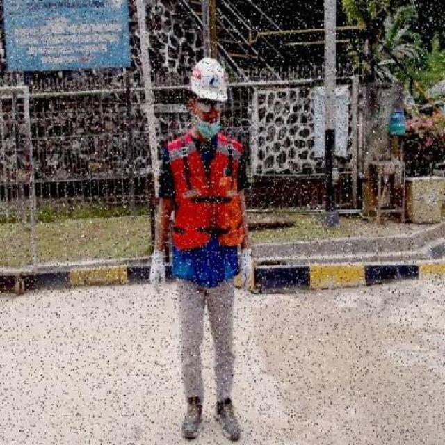
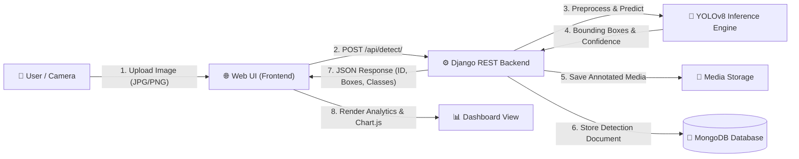

<div align="center">

# 🛡️ PPE Detection System — Industrial Safety Vision
### Automated Computer Vision System for Personal Protective Equipment Compliance Monitoring

[](https://www.python.org/)
[](https://www.djangoproject.com/)
[](https://github.com/ultralytics/ultralytics)
[](https://www.mongodb.com/)
[](https://opencv.org/)
[](LICENSE)

<p align="center">
  <b>An end-to-end AI-powered web solution designed to detect and verify Personal Protective Equipment (Hard Hats, Safety Vests, Masks, Gloves, Safety Boots) on industrial construction and manufacturing sites.</b>
</p>

[Key Features](#-key-features) •
[Demo & Screenshots](#-demo--visual-results) •
[Architecture](#-system-architecture) •
[Tech Stack](#-tech-stack) •
[Quickstart](#-getting-started) •
[API Reference](#-api-documentation) •
[Roadmap](#-future-roadmap)

---

</div>

## 📌 Context & Problem Statement

Workplace safety compliance (EHS / HSE standards) is critical in hazardous environments such as construction sites, factories, chemical plants, and heavy industries. Failure to wear mandatory **Personal Protective Equipment (PPE / EPI)** leads to severe accidents and costly regulatory sanctions.

Manual inspection by safety officers is time-consuming, intermittent, and prone to human error. **PPE Safety Vision** automates this process using **Deep Learning (YOLOv8)** and a scalable **Django & MongoDB web platform**, enabling real-time detection, instant visual reports, and data persistence for safety audits.

---

## 🎯 Key Features

- **⚡ Real-Time Multi-Class PPE Detection**:
  Accurately detects 6 critical industrial safety classes:
  - 🪖 **Hard Hat** (Casque de chantier)
  - 🦺 **Safety Vest** (Gilet haute visibilité)
  - 😷 **Mask** (Masque de protection)
  - 🧤 **Gloves** (Gants de protection)
  - 🥾 **Safety Boots** (Chaussures de sécurité)
  - 👤 **Person** (Opérateur / Ouvrier)

- **🖥️ Modern Glassmorphism Web Interface**:
  - Drag-and-drop image upload with live processing indicators.
  - Interactive results viewer with image zoom modal and download button.
  - Dynamic analytics dashboard powered by **Chart.js** displaying confidence scores and class distribution.

- **🗄️ NoSQL Data Persistence (MongoDB)**:
  - Stores detection metadata, bounding box coordinates (`xyxy`), confidence levels, and execution timestamps.
  - Readily accessible for safety auditing, compliance tracking, and historical metrics.

- **🔌 RESTful Architecture**:
  - Decoupled API endpoints allowing easy integration with IP cameras (RTSP), drones, mobile apps, or edge devices.

---

## 📸 Demo & Visual Results

<div align="center">
  
  <p><i>Figure 1: Example of bounding box detections with class labels and confidence metrics.</i></p>
</div>

---

## 🏗️ System Architecture



---

## 🛠️ Tech Stack

| Domain | Technologies & Libraries |
| :--- | :--- |
| **Deep Learning & CV** | [Ultralytics YOLOv8](https://github.com/ultralytics/ultralytics), PyTorch, OpenCV, Pillow |
| **Backend Framework** | Python 3.10+, Django 4.2+, Django REST Framework, django-cors-headers |
| **Database** | MongoDB (NoSQL document store), PyMongo |
| **Frontend** | HTML5, Modern CSS3 (Glassmorphism UI), Vanilla JavaScript (ES6+), Chart.js |
| **Dataset Source** | Roboflow PPE Industrial Dataset |
| **Version Control** | Git, GitHub |

---

## 📂 Project Structure

```text
ppe_project/
├── backend/
│   ├── detection_app/         # Django core app
│   │   ├── utils.py           # YOLO model loader & inference pipeline
│   │   ├── views.py           # API endpoints (detect_ppe, get_result)
│   │   └── urls.py            # Routing for detection endpoints
│   ├── ppe_backend/           # Django project configuration
│   │   ├── settings.py        # Environment & Django settings
│   │   └── urls.py            # Global URL routing
│   ├── manage.py              # Django management script
│   └── requirements.txt       # Backend dependencies
├── frontend/
│   ├── static/                # Static assets
│   │   ├── styles.css         # Modern glassmorphism stylesheet (Home)
│   │   ├── results1.css       # Analytics dashboard stylesheet
│   │   ├── upload.js          # File upload & progress management
│   │   └── results1.js        # Dynamic rendering & Chart.js analytics
│   └── templates/             # HTML templates
│       ├── index.html         # Main upload view
│       └── result.html        # Detailed detection & analytics view
├── model/                     # Trained YOLO weights directory (.gitkeep)
│   └── best.pt                # Trained model weights (place your file here)
├── docs/
│   └── assets/                # Documentation & README assets
├── .env.example               # Environment variables template
├── .gitignore                 # Optimized Git ignore file
├── LICENSE                    # MIT License
├── README.md                  # Project documentation
└── requirements.txt           # Root project dependencies
```

---

## 🚀 Getting Started

Follow these instructions to run the project locally.

### 1. Prerequisites
- **Python**: 3.10 or higher
- **MongoDB**: Installed and running locally (`mongodb://localhost:27017`) or via [MongoDB Atlas](https://www.mongodb.com/atlas)
- **Git**

### 2. Clone the Repository
```bash
git clone https://github.com/ranimbr/Personal-Protective-Equipment-Detection-System.git
cd Personal-Protective-Equipment-Detection-System
```

### 3. Create a Virtual Environment
```bash
# On Linux/macOS
python3 -m venv venv
source venv/bin/activate

# On Windows (PowerShell)
python -m venv venv
.\venv\Scripts\Activate.ps1
```

### 4. Install Dependencies
```bash
pip install --upgrade pip
pip install -r requirements.txt
```

### 5. Configure Environment Variables
Copy the example `.env` file and adjust settings as needed:
```bash
cp .env.example .env
```

### 6. Place Model Weights
Place your trained YOLO weight file into the `model/` directory:
```bash
model/best.pt
```
> **Note:** If `best.pt` is not present, the system will automatically fall back to standard `yolov8n.pt` for testing purposes.

### 7. Run the Application
Start the Django development server:
```bash
cd backend
python manage.py runserver
```

Open your browser and navigate to:
```
http://127.0.0.1:8000/
```

---

## 📡 API Documentation

### 1. Detect PPE in Image
- **Endpoint**: `POST /api/detect/`
- **Content-Type**: `multipart/form-data`
- **Body**: `image: <file>`
- **Sample Response**:
  ```json
  {
    "id": "6743389a9c8b7f12e4d0a1b2",
    "annotated": "/media/annotated/83044d93-0777-4615-b24f-4df1df84.jpg",
    "boxes": [
      [145.2, 54.1, 230.8, 120.4],
      [110.5, 130.0, 310.2, 400.1]
    ],
    "classes": [1, 5],
    "confidences": [0.92, 0.88]
  }
  ```

### 2. Retrieve Detection Result
- **Endpoint**: `GET /api/result/<id>/`
- **Sample Response**:
  ```json
  {
    "_id": "6743389a9c8b7f12e4d0a1b2",
    "filename": "83044d93-0777-4615-b24f-4df1df84.jpg",
    "original_path": "media/original/83044d93-0777-4615-b24f-4df1df84.jpg",
    "annotated_path": "media/annotated/83044d93-0777-4615-b24f-4df1df84.jpg",
    "boxes": [...],
    "classes": [1, 5],
    "confidences": [0.92, 0.88],
    "created_at": "2026-11-24T14:30:00"
  }
  ```

---

## 🔮 Future Roadmap

- [ ] **Live RTSP Stream Processing**: Direct real-time inference on IP surveillance camera feeds.
- [ ] **Real-Time Alert Notifications**: Instant email / SMS / webhook alerts on PPE violations.
- [ ] **Containerization**: Full Docker & Docker Compose setup (Django, MongoDB, Celery worker).
- [ ] **Admin Analytics Dashboard**: Statistical dashboard with weekly compliance rates per site or zone.

---

## 📄 License

Distributed under the MIT License. See [LICENSE](LICENSE) for more information.

---

## 👤 Author & Contact

**Ranim Ben Rejeb**  
- **GitHub**: [@ranimbr](https://github.com/ranimbr)  
- **Role**: Junior Python & Web Developer | Computer Vision & Machine Learning Enthusiast  

---

<div align="center">
  <sub>⭐ If you find this project useful or interesting, feel free to give it a star on GitHub!</sub>
</div>
